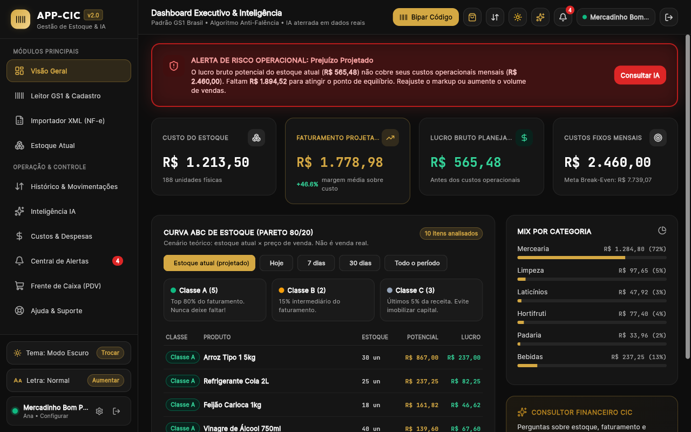
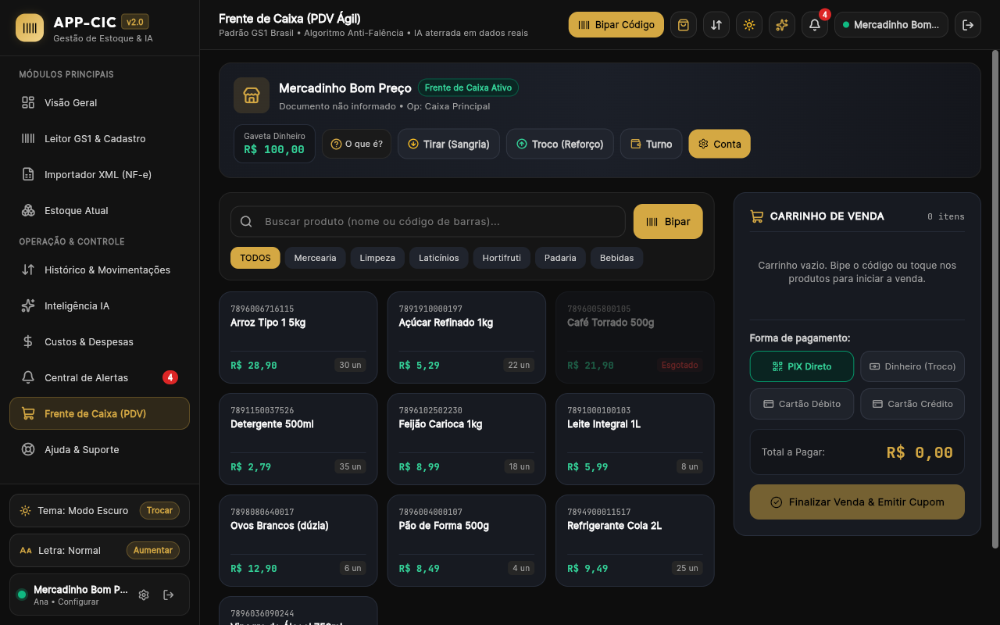
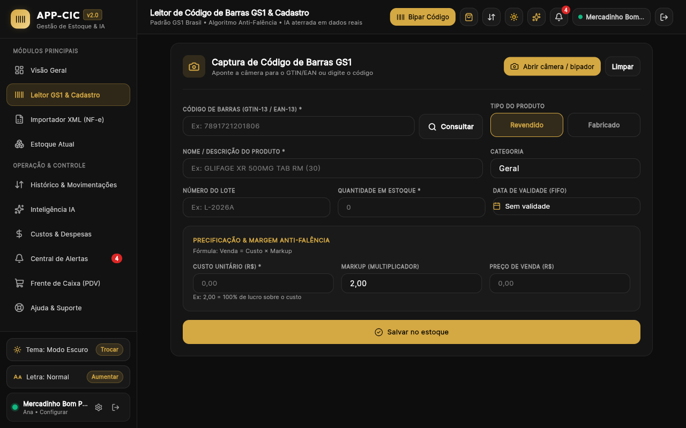
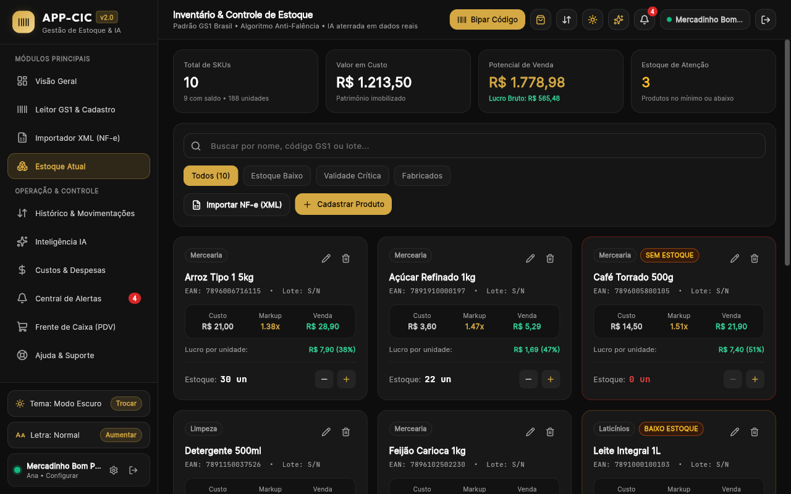
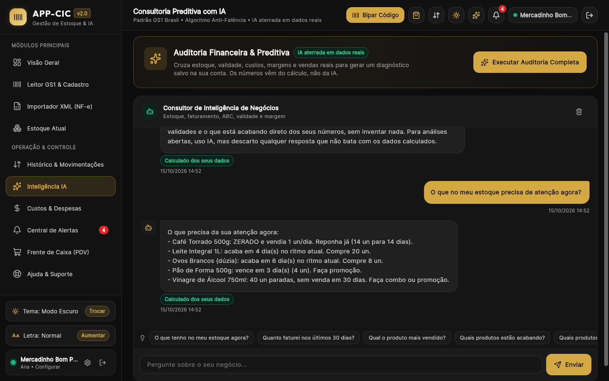

# APP-CIC

O APP-CIC ajuda pequenos lojistas a vender, controlar o estoque e entender os números do negócio em um só aplicativo. Funciona na web e no Android, com leitura de códigos de barras, frente de caixa e um assistente orientado pelos dados calculados da loja.

É voltado a quem precisa acompanhar produtos, validade, reposição e custos sem depender de várias planilhas. O modo demonstração permite conhecer o fluxo com dados em memória.

## Funcionalidades e vantagens

- **PDV:** carrinho, registro da forma de pagamento, abertura e fechamento de caixa. A venda registra histórico e baixa o estoque na mesma transação, reduzindo divergências de saldo.
- **Leitor de código de barras GS1:** leitura pela câmera e identificação pelo código para agilizar cadastro e busca. Reconhecer o código não garante a disponibilidade de todos os dados comerciais do produto.
- **Estoque com validade:** saldo atual, lote, custo, preço, estoque mínimo, categoria e movimentações. Também há importação por XML de NF-e.
- **Curva ABC:** classificação calculada para identificar produtos de maior participação nas vendas e priorizar a atenção. O modo projetado é separado do realizado.
- **Assistente com IA e proteção contra números inventados:** perguntas objetivas usam cálculos locais. Análises abertas passam por uma trava de aterramento; inconsistências detectadas são descartadas e substituídas por dados calculados com aviso. A proteção reduz alucinações, mas não garante toda afirmação em linguagem natural.
- **Alertas:** estoque baixo, validade e situações que merecem atenção, com histórico e marcação de leitura.
- **Custos e ponto de equilíbrio:** despesas fixas e variáveis e estimativa de faturamento necessário para cobri-las, conforme a margem usada no cálculo. Projeção não é receita já realizada.

A release `release-blindada` (PR #7), conferida localmente no commit `740534b`, reúne previsão de demanda por média móvel de 30 dias, a cadeia Gemini → Groq → Ollama → OpenRouter e os controles de segurança. Esta documentação descreve essa release; a consulta foi feita aos arquivos locais, sem verificar implantação em produção.

## Como funciona o assistente

O app responde primeiro com regras calculadas: atenção, poucas unidades, validade, se a loja está ganhando dinheiro, retorno, cobertura de custos e reposição, além de estoque e ABC. A previsão usa as vendas dos últimos 30 dias, com horizonte padrão de reposição de 14 dias. Só perguntas abertas sobre o negócio seguem para a Edge Function `ia-consultor`.

Antes de chamar o modelo, o servidor converte os campos monetários em centavos para textos em reais, como `R$ 1.234,56`. No limite 429 ou indisponibilidade 503, o Groq tenta outras combinações das duas chaves configuráveis com três modelos padrão. Ao final, o servidor substitui ou remove nomes internos de campos da resposta. O app ainda valida o conteúdo e descarta números inventados detectados.

A resposta passa por validação do contexto antes de ser exibida. Se faltar configuração, houver timeout ou inconsistência detectada, o app mostra os dados calculados disponíveis. Isso exige dados confiáveis já carregados; não é uma promessa de sincronização offline completa.

As camadas gratuitas têm limites. Ollama pode usar o serviço remoto configurado por chave ou uma URL própria acessível pela Edge Function. Na opção hospedada no computador do desenvolvedor, a máquina precisa permanecer ligada. [Veja a sequência completa](docs/arquitetura/sequencia-assistente.md).

## Segurança

- **RLS por loja:** os SQLs definem isolamento por `empresa_id = auth.uid()`. As funções de escrita validam o usuário e usam sua loja. A proteção depende das migrações e permissões aplicadas no Supabase.
- **Credenciais:** o Flutter recebe a URL e a chave pública `anon`. Chaves de IA e `service_role` ficam no servidor, nunca em `--dart-define`, imagens ou arquivos públicos.
- **Senha forte:** o cadastro exige ao menos 12 caracteres, com maiúsculas, minúsculas e números. Há bloqueio local após cinco falhas, por 15 minutos, em janela de cinco minutos. No painel Supabase, configurar confirmação de e-mail, política de senha e limites de tentativas; o controle no cliente não substitui o servidor.
- **CSP e headers web:** `vercel.json` inclui CSP, HSTS, `X-Frame-Options`, `X-Content-Type-Options`, `Referrer-Policy` e `Permissions-Policy`. A compilação configurada no Vercel remove arquivos `.map` do resultado web.
- **Build ofuscado:** releases Android/iOS devem usar `--obfuscate --split-debug-info`. Guardar os símbolos fora dos artefatos públicos. Ofuscação dificulta a leitura do binário, mas não substitui RLS nem protege segredos embutidos.

O logout limpa o estado da loja e as preferências de sessão/cache/tentativas, preservando o tema. A migração `supabase/seguranca_app_rls.sql` acrescenta políticas restritivas por dono. Esta documentação não verificou o painel nem a aplicação dessas configurações em produção. Consulte o [modelo de dados e políticas](docs/arquitetura/modelo-de-dados.md).

## Stack

| Camada | Tecnologia |
| --- | --- |
| Aplicativo | Flutter / Dart, web e Android |
| Regras de negócio | Pacote local `packages/cic_domain`, em Dart |
| Autenticação e dados | Supabase Auth, PostgreSQL, RLS e RPCs |
| Backend de IA | Supabase Edge Functions, TypeScript / Deno |
| Leitura e importação | `mobile_scanner`, integração de leitor web e parser XML |
| Publicação web | Vercel, configurado em `vercel.json` |

## Como rodar

### Pré-requisitos

- Flutter SDK com Dart compatível com `^3.11.4`, conforme `pubspec.yaml`.
- Chrome ou Edge para web; Android SDK e aparelho/emulador para Android.
- Câmera e permissão de uso para testar o leitor.
- Projeto Supabase configurado para dados reais.

### Aplicativo

Na raiz do repositório:

```sh
flutter doctor
flutter pub get
flutter run -d chrome --dart-define=SUPABASE_URL=https://SEU-PROJETO.supabase.co --dart-define=SUPABASE_ANON_KEY=SUA_CHAVE_ANON_PUBLICA
```

Para Android, selecione o identificador retornado por `flutter devices`:

```sh
flutter devices
flutter run -d ID_DO_DISPOSITIVO --dart-define=SUPABASE_URL=https://SEU-PROJETO.supabase.co --dart-define=SUPABASE_ANON_KEY=SUA_CHAVE_ANON_PUBLICA
```

Os valores acima são exemplos. `lib/core/config.dart` possui configurações públicas padrão; use os parâmetros para apontar para seu próprio ambiente. Para abrir a demonstração sem login, use a configuração de build abaixo.

### Modo demonstração e gravação dos tutoriais

```sh
flutter build web --dart-define=DEMO=true
```

Para executar durante o desenvolvimento:

```sh
flutter run -d chrome --dart-define=DEMO=true
```

`Config.demo` seleciona `DemoRepository`, definido em `lib/data/repository_demo.dart`. O app abre uma loja de exemplo sem login, com estoque, vendas, custos e caixa em memória; alterações se perdem quando essa instância é recriada. Os registros da loja de exemplo não são persistidos no banco.

Perguntas abertas ao assistente podem enviar a pergunta e o contexto de exemplo à Edge Function. Sem sessão, o app usa a chave pública nesse modo; a aceitação depende da configuração implantada. Se a chamada falhar, continua disponível a resposta calculada. O modo demonstração não dispensa toda conexão externa: o app inicializa o cliente Supabase e pode usar outros serviços.

### Supabase

1. Configure Auth e as URLs de redirecionamento. Ative confirmação de e-mail, política de senha e limites de autenticação.
2. Obtenha o schema inicial de `produtos`, `historico_vendas` e `custos_operacionais` e revise as evoluções em `supabase/`. Os SQLs locais não constituem um bootstrap completo de banco vazio. Não execute todos em ordem alfabética: há scripts de limpeza e relações antigas substituídas pela v3.
3. Aplique as migrações revisadas e confira o isolamento com duas contas distintas. Veja as fontes no [modelo de dados](docs/arquitetura/modelo-de-dados.md).
4. Cadastre os secrets no painel de Edge Functions e publique `ia-consultor`. Configure os provedores desejados: `GEMINI_API_KEY`/`GEMINI_MODEL`; `GROQ_API_KEY`, `GROQ_API_KEY_2` e `GROQ_MODEL`; `OLLAMA_API_KEY`, `OLLAMA_URL` e `OLLAMA_MODEL`; `OPENROUTER_API_KEY`/`OPENROUTER_MODEL`. Só os provedores configurados participam da cadeia. Os campos de modelo são opcionais; a segunda chave Groq também é opcional.

Com a Supabase CLI autenticada, publique a função no seu projeto:

```sh
supabase functions deploy ia-consultor --project-ref SEU_PROJECT_REF
```

Esses passos são instruções de implantação, não operações executadas pela documentação.

### Testes

```sh
flutter test
cd packages/cic_domain
dart pub get
dart test
```

Volte à raiz antes de executar os builds.

## Builds de produção

Web:

```sh
flutter build web --release --no-source-maps --dart-define=SUPABASE_URL=https://SEU-PROJETO.supabase.co --dart-define=SUPABASE_ANON_KEY=SUA_CHAVE_ANON_PUBLICA
```

Publique apenas `build/web` e confira a ausência de arquivos `.map`. CSP e demais headers são aplicados pela hospedagem, não pela compilação. A release já configura esses headers e remove source maps em `vercel.json`.

Android:

```sh
flutter build appbundle --release --obfuscate --split-debug-info=build/symbols/android --dart-define=SUPABASE_URL=https://SEU-PROJETO.supabase.co --dart-define=SUPABASE_ANON_KEY=SUA_CHAVE_ANON_PUBLICA
```

Para distribuição direta, use `flutter build apk` com os mesmos parâmetros. Configure assinatura de release e preserve os símbolos por versão em armazenamento privado.

O projeto também contém estrutura iOS. Compilar exige macOS, Xcode, assinatura e validação nessa plataforma:

```sh
flutter build ipa --release --obfuscate --split-debug-info=build/symbols/ios --dart-define=SUPABASE_URL=https://SEU-PROJETO.supabase.co --dart-define=SUPABASE_ANON_KEY=SUA_CHAVE_ANON_PUBLICA
```

## Arquitetura e diagramas

- [Índice e versão documentada](docs/arquitetura/README.md)
- [Casos de uso do lojista](docs/arquitetura/casos-de-uso.md)
- [Componentes do aplicativo e backend](docs/arquitetura/componentes.md)
- [Sequência de uma pergunta ao assistente](docs/arquitetura/sequencia-assistente.md)
- [Classes do domínio e previsão de demanda](docs/arquitetura/classes-dominio.md)
- [Modelo de dados, chaves e RLS](docs/arquitetura/modelo-de-dados.md)

## Tutoriais em vídeo

**Assista:** [treinamento completo e os 11 módulos narrados](https://github.com/yago-silva-ads/app-cic/releases/tag/tutoriais)
(loja de demonstração, dados fictícios), mais um vídeo vertical de divulgação.

O material de produção está em [docs/tutorial](docs/tutorial/):

- [Roteiro de treinamento](docs/tutorial/roteiro.md), com cenas e narração por módulo.
- [Artes dos vídeos](docs/tutorial/arte/): abertura, encerramento, capas e post de divulgação.
- [Gerador das artes](docs/tutorial/arte/gerar_arte.py), para reproduzir os PNGs com Python e Pillow.
- [Ferramentas de gravação](docs/tutorial/ferramentas/): grava as telas, narra em pt-BR e monta os vídeos.

## Telas

Capturas da loja de demonstração em `docs/prints/`.

### Início



### Vender



### Leitor



### Estoque



### Assistente



## Segurança e builds de publicação

O app contém somente a chave pública `anon` do Supabase. Chaves `service_role` e
de provedores de IA devem ficar em secrets no servidor, nunca em `--dart-define`
nem no código Flutter. O build da Vercel remove arquivos `.map` do artefato web.

Para aplicar o isolamento multi-loja, revise e execute
`supabase/seguranca_app_rls.sql` no SQL Editor do projeto Supabase. A migration
falha se encontrar uma tabela de negócio sem `empresa_id`, `user_id` ou
`owner_id` associado a `auth.uid()`.

Builds móveis de release usam obfuscação e geram símbolos separados:

```sh
bash tool/build_mobile.sh android
bash tool/build_mobile.sh ios
```

O build de iOS precisa rodar no macOS com Xcode. Guarde `build/symbols/` em local
privado e junto da versão publicada; os arquivos são necessários para decodificar
relatórios de falha e não devem ser distribuídos com o app.

No painel Supabase, mantenha a confirmação de e-mail habilitada em
Authentication / Providers / Email, configure senha mínima de 12 caracteres com
letras maiúsculas, minúsculas e números, e ajuste limites de envio/login em
Authentication / Rate Limits. O bloqueio no app é apenas uma camada de interface
e não substitui o limite do servidor.


