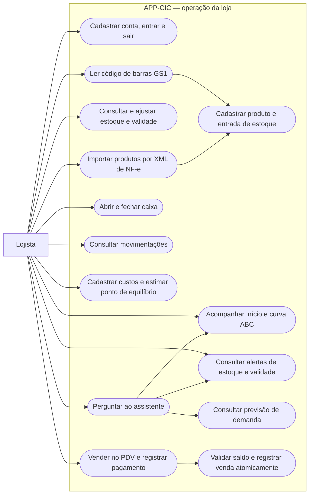

# Casos de uso do lojista

Representação dos casos de uso com `flowchart`, compatível com Mermaid no GitHub. As setas identificam acesso e dependências funcionais; não representam a ordem de todas as telas.

O acesso aos dados reais depende de sessão autenticada e das políticas da loja. O build com `--dart-define=DEMO=true` usa `Config.demo` e `DemoRepository` para abrir uma loja de exemplo em memória sem login; perguntas abertas ao assistente ainda podem usar a Edge Function.

No PDV, informar Pix ou outra forma de pagamento registra o método; isso não equivale a uma confirmação automática por instituição financeira. A previsão de demanda está implementada na release em `PrevisaoDemanda`, com janela padrão de 30 dias e horizonte de reposição de 14 dias.

Fontes: [telas](../../lib/screens/), [repositório de dados](../../lib/data/repository.dart) e [venda atômica](../../supabase/migracao_v3_estoque_atomico_e_isolamento.sql).
