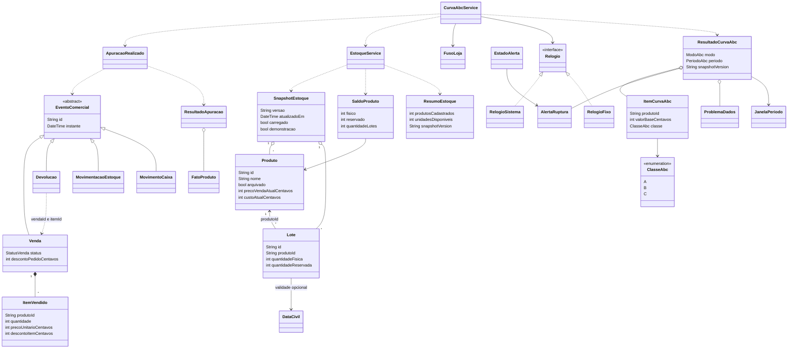
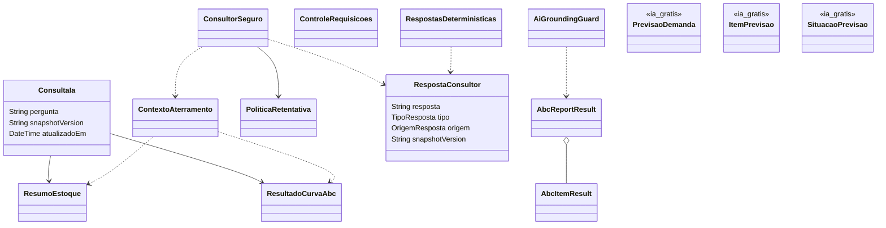

# Classes do domínio

Visão resumida de `packages/cic_domain`, com atributos selecionados. Dinheiro usado nos cálculos do domínio é representado em centavos inteiros. `Produto` aqui é o objeto do domínio, distinto do modelo de persistência em `lib/data/models.dart`.

Campos opcionais foram simplificados no desenho: preços e custos atuais de `Produto`, por exemplo, podem ser nulos. Um saldo desconhecido não deve ser convertido em zero.

`ControleRequisicoes` é usado pelo serviço do app para ignorar respostas antigas. A validação do fluxo atual passa por `ConsultorSeguro` e pela função `verificarAterramento`; `AiGroundingGuard` e os contratos `AbcReportResult`/`AbcItemResult` também existem no pacote, mas não são a mesma implementação desse fluxo.

Os três nomes de previsão foram incluídos conforme o branch `ia-gratis` informado pelo responsável: `PrevisaoDemanda` representa a funcionalidade de previsão, `ItemPrevisao` seus itens e `SituacaoPrevisao` sua situação. Não há declaração local para confirmar campos, métodos, valores de enum ou associações, por isso eles aparecem sem relações inventadas. A regra funcional solicitada é a média móvel de 30 dias.

Fontes: [estoque](../../packages/cic_domain/lib/src/estoque/estoque.dart), [eventos comerciais](../../packages/cic_domain/lib/src/vendas/eventos.dart), [apuração](../../packages/cic_domain/lib/src/vendas/apuracao.dart), [ABC](../../packages/cic_domain/lib/src/abc/curva_abc.dart), [tempo](../../packages/cic_domain/lib/src/tempo/), [IA](../../packages/cic_domain/lib/src/ia/), [guard adicional](../../packages/cic_domain/lib/services/ai_grounding_guard.dart) e [contrato ABC](../../packages/cic_domain/lib/contracts/abc_contract.dart).
