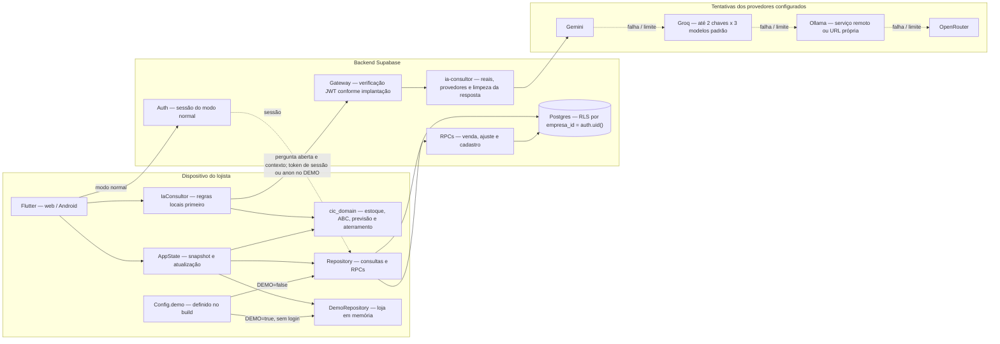

# Componentes

Arquitetura conferida na release `release-blindada`, commit `740534b`. O Flutter atende web e Android; `cic_domain` concentra cálculos e validação. No modo normal, Supabase Auth e Postgres atendem a conta da loja.

`AppState` recebe apenas o repositório selecionado. O desenho mostra as duas alternativas, não gravações simultâneas. `flutter build web --dart-define=DEMO=true` ativa `Config.demo`; `lib/main.dart` injeta `DemoRepository` de `lib/data/repository_demo.dart` e abre a loja sem login. Os registros ficam em memória e são recriados com a instância. Perguntas abertas ainda podem enviar contexto de exemplo ao servidor.

As setas entre provedores representam a ordem de tentativa coordenada pela função. A lista ignora provedores sem configuração. No Groq, há até duas chaves e três modelos padrão; `GROQ_MODEL` pode acrescentar um modelo distinto. O rodízio acontece em 429/503 e respeita o tempo restante.

O servidor converte campos monetários `*Centavos` em textos `*Reais` antes do modelo. A saída passa por `semCampos`, que traduz ou remove nomes internos conhecidos. O app confere novamente o contrato e o aterramento.

O gateway é responsável pela verificação de JWT quando habilitada; `usuarioDoJwt` apenas extrai o identificador para o limite em memória, sem validar assinatura por si só. No DEMO, sem sessão, o cliente envia a chave pública como bearer. A aceitação depende da implantação; em caso de recusa, o app usa o fallback calculado.

Ollama usa `OLLAMA_URL` ou, com chave e sem URL, `https://ollama.com`. Servidor próprio precisa estar ligado e acessível. “Grátis” depende das cotas e modelos disponíveis. Chaves de IA e `service_role` não pertencem ao build Flutter.

Fontes na release: `lib/main.dart`, `lib/core/config.dart`, `lib/data/repository_demo.dart`, [AppState](../../lib/state/app_state.dart), [Repository](../../lib/data/repository.dart), [IaConsultor](../../lib/services/ia_consultor.dart), [domínio](../../packages/cic_domain/lib/) e [Edge Function](../../supabase/functions/ia-consultor/index.ts).
