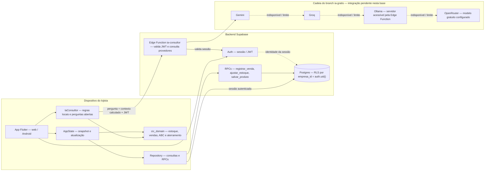

# Componentes

O Flutter atende web e Android. O pacote Dart `cic_domain` concentra regras reutilizáveis; o Supabase autentica o lojista e persiste os dados. A Edge Function recebe o token da sessão e mantém as credenciais dos provedores no servidor.

As setas entre provedores representam a ordem de tentativa coordenada pela Edge Function, não chamadas de um provedor para outro. Na base `643fdd6`, o arquivo da função contém Gemini e DeepSeek opcional; a cadeia acima documenta a integração solicitada de `ia-gratis`.

“Grátis” depende das cotas e modelos disponíveis. Ollama precisa de uma máquina ligada e alcançável pelo backend: `localhost` dentro da Edge Function não é o computador do desenvolvedor. A indisponibilidade dos provedores deve terminar em resposta calculada no app. As chaves de IA e `service_role` não pertencem ao build Flutter.

Fontes: [AppState](../../lib/state/app_state.dart), [Repository](../../lib/data/repository.dart), [IaConsultor](../../lib/services/ia_consultor.dart), [domínio](../../packages/cic_domain/lib/) e [Edge Function](../../supabase/functions/ia-consultor/index.ts).
