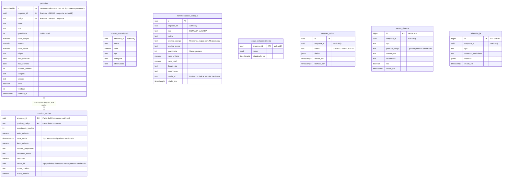

# Modelo de dados e isolamento por loja

Modelo reconstruído dos SQLs versionados em `supabase/`, considerando a evolução v3 e a migração de segurança de `release-blindada`. Não é uma exportação do banco em produção. Os `CREATE TABLE` originais de `produtos`, `historico_vendas` e `custos_operacionais` não estão nesta base; seus campos aparecem em alterações, funções, índices e consultas. O diagrama documenta oito tabelas identificáveis nesses SQLs; a verificação informada pelo responsável abrange dez tabelas no banco de produção, cujos dois nomes adicionais não são afirmados aqui sem catálogo do banco.

No diagrama, `desconhecido` indica tipo não comprovado pelo DDL local. Não foi atribuída PK a `historico_vendas` ou `custos_operacionais` sem evidência da definição original. A migração garante `produtos.id` como PK, mas preserva seu tipo se já existir; cria UUID apenas quando falta a coluna.

`UK` em `produtos` representa uma única constraint `UNIQUE (empresa_id, codigo)`, não duas unicidades independentes. Campos legados como nome, quantidade e valores têm tipos lógicos deduzidos dos usos SQL; precisão e restrições originais exigem conferir o schema implantado. O app também usa `custos_operacionais.id`, mas o DDL desse identificador não está nos SQLs locais, portanto sua chave e tipo não são afirmados no desenho.

## Relações e integridade

- `historico_vendas (empresa_id, produto_codigo)` referencia `produtos (empresa_id, codigo)` com `ON DELETE RESTRICT`. Um código de barras pode existir em lojas diferentes. Produtos com histórico podem ser arquivados em vez de apagados.
- `venda_id` agrupa linhas do histórico e movimentos gerados na mesma venda. Não existe `CREATE TABLE vendas` nesses SQLs.
- `movimentacoes_estoque.produto_codigo` e `alertas_sistema.produto_codigo` são referências lógicas; os respectivos `CREATE TABLE` não declaram FK para produtos.
- As oito tabelas desenhadas usam `empresa_id` para isolamento. A blindagem de produção cobre dez tabelas e também reconhece `user_id` ou `owner_id` quando essa for a coluna de dono. Isso não constitui uma FK automaticamente: não foi encontrada declaração de FK para `auth.users` nesses SQLs.
- Não há tabela relacional de clientes ou lotes declarada nos SQLs locais. Não confundir o objeto Dart `Lote` com uma tabela existente.

## RLS e operações

O modelo atual associa a loja ao usuário autenticado: `empresa_id = auth.uid()`. Um `DEFAULT auth.uid()` ajuda a preencher a coluna, mas o controle de acesso vem das políticas `USING` e `WITH CHECK`, das permissões e da validação nas funções. Não há aqui um modelo de múltiplos funcionários por associação a uma empresa separada.

| Operação | Implementação nos SQLs |
| --- | --- |
| Leitura da loja | RLS compara `empresa_id` com `auth.uid()` |
| Venda | `registrar_venda` valida sessão/itens, trava produto, baixa saldo e grava histórico/movimento na mesma transação |
| Ajuste de saldo | `ajustar_estoque` valida loja e saldo e registra movimentação |
| Cadastro e atualização | `salvar_produto` usa a loja do JWT e registra diferença de estoque |
| Movimento histórico | v3 oferece políticas SELECT/INSERT, sem UPDATE/DELETE |
| Perfil e caixa | `contas_estabelecimento` e `sessoes_caixa` têm políticas SELECT/INSERT/UPDATE por dono |

As RPCs de escrita recentes são `SECURITY DEFINER` com `search_path` fixo e filtro explícito por usuário. A RLS isoladamente não substitui essa validação interna. `seguranca_app_rls.sql` habilita RLS e acrescenta uma política `RESTRICTIVE` por dono, combinada por AND com as permissivas. Preserva as operações permitidas em tabelas já configuradas; se não há nenhuma policy permissiva, cria acesso do próprio usuário. Para tabelas de negócio identificadas pelo script sem coluna de dono, falha explicitamente.

**Aplicado em produção (segundo verificação informada pelo responsável):** RLS e política `RESTRICTIVE` em dez tabelas. A conta dona continua vendo as linhas da própria loja; uma conta autenticada de outra loja viu zero linhas no teste. A Edge Function `ia-consultor` exige sessão de usuário; somente a chave pública `anon` recebe 401. Nomes de produto são truncados e tratados como dados no prompt, e o fluxo de IA usa disjuntor e rodízio de provedores. No web, a CSP bloqueia script inline (`script-src` sem `unsafe-inline`), o ZXing é local, o build de publicação fixa `DEMO=false` e o login usa mensagem genérica para e-mail não confirmado.

**Pendente no SQL Editor do dono:** executar `supabase/restringir_funcoes_legadas.sql` para revogar de `anon` a execução das três funções legadas de cron; executar `supabase/limite_ia.sql` para que o limite por minuto seja persistente entre instâncias. Sem o segundo script, a Edge Function recorre ao contador em memória. `limite_ia.sql` foi criado na branch de release, mas não integra esta branch histórica de documentação. **Pendente no painel Auth:** confirmação de e-mail (considerar o limite de envios do SMTP gratuito), senha mínima de 12 caracteres e rate limits. Essas ações não são substituídas por validações do app.

**Testes da release no CI:** 101 do domínio, 25 do app e 13 da Edge Function com provedores falsos. Os testes automatizados não substituem a verificação de grants, RLS e configuração Auth no painel de produção.

## Views e fontes

As views `vw_kpis_vendas_mes`, `vw_top_produtos_mes`, `vw_produtos_validade_critica`, `vw_produtos_estoque_baixo` e `vw_faturamento_mensal` são projeções, não tabelas adicionais. O responsável confirmou `security_invoker` nas views do banco; o script de blindagem também trata a segurança das views e políticas.

| Fonte local | Evidência principal |
| --- | --- |
| [Schema v2](../../supabase/schema_evolucao_v2.sql) | Colunas evolutivas, alertas, relatórios, views e índices |
| [Migração v3](../../supabase/migracao_v3_estoque_atomico_e_isolamento.sql) | PK de produto, UNIQUE/FK compostas, movimentos, conta, caixa e RPCs |
| [RLS inicial](../../supabase/rls_migration.sql) | Isolamento de produtos, histórico e custos |
| [RLS de custos](../../supabase/rls_custos_operacionais.sql) | Políticas de custos |
| [RLS de novas tabelas](../../supabase/rls_novas_tabelas.sql) | Alertas e relatórios |
| [Blindagem de views](../../supabase/blindagem_views_e_rls.sql) | Proteção de consultas derivadas |
| `supabase/seguranca_app_rls.sql` (na release) | RLS e política restritiva; reconhece empresa_id, user_id ou owner_id |
| [Triggers](../../supabase/triggers_inteligentes_v2.sql) | Automatismos de negócio |

O arquivo legado `limpeza_e_trava_not_null.sql` contém exclusões e uma FK antiga somente por código com cascata. Ele não descreve a relação final v3 e não deve ser executado cegamente depois dela. Para um ambiente novo, obter primeiro o schema inicial das três tabelas legadas e revisar a ordem dos scripts; esta documentação não promete um bootstrap completo a partir deles.
