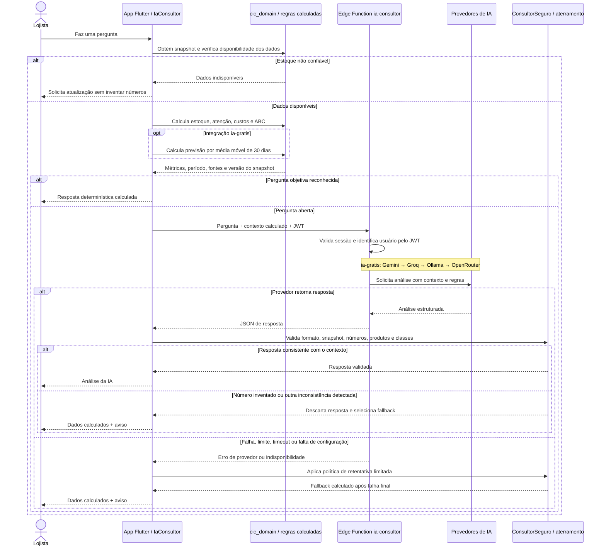

# Sequência de uma pergunta ao assistente

O app calcula os números e usa a IA para interpretar o contexto. Perguntas objetivas têm resposta local. A previsão de demanda por média móvel de 30 dias é a extensão informada para `ia-gratis`; sua implementação não está nesta base.

Na implementação local, `ConsultorSeguro` chama `verificarAterramento` usando `ContextoAterramento`. A validação examina inclusive respostas com HTTP 200: sucesso de transporte não garante conteúdo correto. `ControleRequisicoes` impede que uma resposta antiga substitua uma pergunta mais recente.

O fallback atual combina estoque e ABC calculados. A política configurada em `IaConsultor` permite até duas tentativas com timeout de 18 segundos por tentativa. O esquema exato de previsão e suas regras de falta de histórico devem ser conferidos após integrar `ia-gratis`; média móvel é estimativa, não garantia de vendas futuras.

A trava reduz respostas com dados inventados detectáveis; não comprova toda afirmação em linguagem natural. Dados de origem incorretos também precisam ser tratados pelo app.

Fontes: [IaConsultor](../../lib/services/ia_consultor.dart), [ConsultorSeguro](../../packages/cic_domain/lib/src/ia/consultor_seguro.dart), [aterramento](../../packages/cic_domain/lib/src/ia/guarda_aterramento.dart) e [retentativas](../../packages/cic_domain/lib/src/ia/erros_ia.dart).
